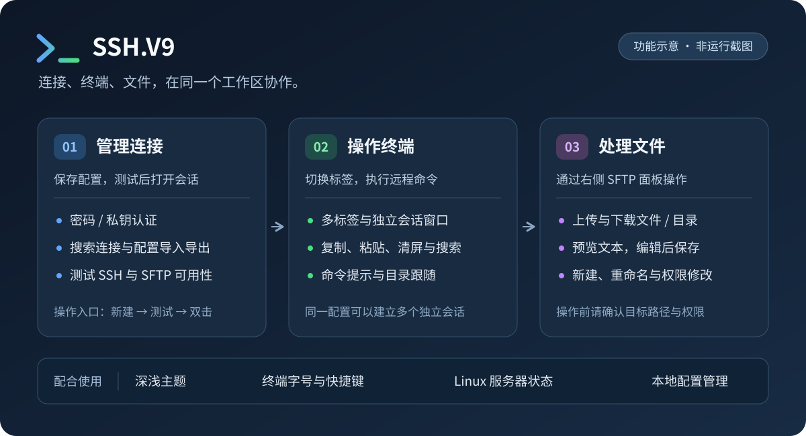

<p align="center">
  
</p>

<h1 align="center">SSH.V9</h1>

<p align="center">面向 Windows 的 SSH / SFTP 桌面客户端</p>

在一个工作区里管理连接、操作远程终端和传输文件。SSH.V9 基于 Electron、xterm.js 和 ssh2，适合需要在多个服务器会话间切换，同时查看、编辑远程文件的日常工作。

**维护者：** [EugeneEvan](https://github.com/EugeneEvan) · **应用名称：** SSH · **许可证：** [MIT](LICENSE)

[功能概览](#功能概览) · [从源码运行](#从源码运行) · [使用指南](#使用指南) · [Windows 打包](#windows-打包) · [数据与安全](#数据与安全)



> 上图是依据现有功能绘制的操作流程示意图，并非实际运行截图。图中没有真实服务器信息。

## 功能概览

| 工作区域 | 可以做什么 |
| --- | --- |
| 连接管理 | 保存、搜索和编辑连接；使用密码或私钥认证；测试 SSH / SFTP；导入、导出连接配置；隐藏首页中的部分连接信息。 |
| SSH 终端 | 同时打开多个标签；为同一连接创建独立会话；打开独立窗口；复制、粘贴、清屏、搜索终端内容；查看命令提示。 |
| SFTP 文件 | 浏览、搜索和排序当前目录；上传、下载文件及目录；新建、重命名、修改权限；预览和编辑文本文件并保存回服务器。 |
| 终端与文件协作 | 通过“跟随”查看终端当前目录；按需查看服务器 CPU、内存、磁盘与进程信息。 |
| 外观与设置 | 切换深色 / 浅色主题，调整终端字号、面板宽度、快捷键、鼠标侧键操作及连接配置保存位置。 |

项目以 Windows 10 为目标。当前仓库提供源码，尚未发布 Releases 安装包；其他桌面平台的运行与打包兼容性未在本文中作出承诺。

## 从源码运行

准备 Windows 开发环境、Git、Node.js 和 npm。首次安装需要联网下载 npm 依赖及 Electron。

```powershell
git clone https://github.com/EugeneEvan/SSH.V9.git
cd SSH.V9
npm ci
npm start
```

`npm ci` 按仓库内的 `package-lock.json` 安装依赖，`npm start` 启动桌面应用。如果已有本地源码，在项目根目录执行后两条命令即可。

入口为 [`src/main/main.js`](src/main/main.js)，运行与构建命令定义在 [`package.json`](package.json)。本 README 介绍现有源码用法，不代表已对你的系统或目标服务器完成兼容性测试。

## 使用指南

### 1. 新建并测试连接

1. 在首页点击 **新建**，或在左侧连接面板的 **更多 → 新建连接** 中打开表单。
2. 填写连接名称、主机、端口和用户名，选择密码认证或本地私钥文件；需要时填写私钥口令。
3. 测试连接，查看 SSH 与 SFTP 是否可用，再保存配置。
4. 在连接列表中双击打开会话。再次双击同一连接可创建新的独立会话，标签会追加 `(2)`、`(3)` 等编号。

首页支持搜索和 **脱敏** 显示。脱敏仅影响部分界面展示；分享截图前仍需检查终端输出、路径、用户名和主机信息。

### 2. 使用终端和独立窗口

连接后，在中间的终端区域执行远程命令。通过顶部标签切换会话，右键标签可复制为新标签、打开为新窗口或关闭一组标签。

**打开为新窗口会使用同一配置建立独立会话，原标签仍保留。** 它不会把正在运行的终端进程搬到新窗口。

右侧的 **提示** 控制命令提示，**跟随** 让文件面板跟随终端目录；跟随依赖远程 Shell 的目录信息，遇到不支持的环境时可关闭并手动浏览目录。

### 3. 传输和编辑远程文件

| 操作 | 使用方法 |
| --- | --- |
| 浏览目录 | 在右侧 SFTP 列表进入文件夹，使用面包屑切换路径；搜索框筛选当前目录。 |
| 上传 | 点击 **上传**，选择本地文件或目录，上传到当前远程目录；文件面板也支持拖入本地文件。 |
| 下载 | 选择文件或目录后点击 **下载**，可下载多个选中条目。 |
| 编辑文本 | 打开远程文本文件，在编辑器修改后保存，内容会写回远程服务器。 |
| 文件管理 | 在文件列表右键新建文件 / 文件夹、重命名、修改权限或删除。 |
| 查看运行状态 | 连接后点击 **状态**，查看 CPU、内存、磁盘和进程信息。 |

使用时请注意这些边界：

- 文本预览默认上限为 **2 MiB**；超过限制时不自动读取，疑似二进制文件禁用文本编辑。文本按 UTF-8 读取和保存，其他编码的文件应先确认编码。
- 保存编辑内容会直接写入远程文件，修改重要配置前请先备份。
- 删除文件夹只支持**空目录**，不提供递归删除非空目录的操作。
- 文件操作受远程账号权限和 SFTP 服务配置限制；SSH 能连接不代表 SFTP 一定可用。
- 服务器状态读取依赖 Linux 的 `/proc`、`free`、`df`、`top` 和 `ps` 等工具，其他系统或缺少这些工具时可能无法显示完整数据。

### 4. 常用快捷键

以下为默认设置；可以在应用设置中调整。终端操作需要当前存在活动会话。

| 快捷键 | 用途 |
| --- | --- |
| `Ctrl+Shift+C` | 复制终端选中的文本 |
| `Ctrl+Shift+V` | 向终端粘贴剪贴板文本 |
| `Ctrl+Shift+L` | 清空终端显示 |
| `Ctrl+F` | 搜索当前终端内容 |

粘贴的文本会交给远程 Shell 处理，粘贴多行命令前请先确认内容。

### 5. 主题、导入与导出

点击窗口右上角 **设置**，可切换深浅主题、调整终端字体、配置快捷键和连接信息保存位置。

在左侧连接面板的 **更多** 菜单选择 **导入连接** 或 **导出连接**。导出时可以选择连接条目，默认不勾选包含密码与口令；需要迁移凭据时，先阅读下面的数据说明。

## Windows 打包

先完成 `npm ci`，再在 Windows 的项目根目录执行所需命令：

| 命令 | 构建结果 |
| --- | --- |
| `npm run pack` | 生成应用目录，用于检查打包内容。 |
| `npm run dist:win` | 生成 Windows NSIS 安装包和 portable 便携包。 |

```powershell
npm run dist:win
```

构建输出目录为 `release/`。NSIS 配置支持选择安装目录，并创建桌面和开始菜单快捷方式。构建过程可能需要下载 Electron / electron-builder 相关资源；这里描述的是仓库构建配置，未提供已验证的预构建安装包或签名承诺。

## 数据与安全

### 连接配置保存在哪里

默认路径是 Electron 用户数据目录下的 `profiles/profiles.json`，即 `app.getPath('userData')` 对应目录中的 `profiles` 子目录。应用设置会显示默认位置和当前位置，可选择新的保存目录。

切换目录时，程序会把当前连接配置写入新位置；如果目标位置已有不同的 `profiles.json`，会先在目标目录生成带时间戳的备份。旧位置的文件不会自动删除，请自行管理备份和迁移后的副本。

### 密码与导出文件

- 系统加密可用时，密码和私钥口令使用 Electron `safeStorage` 保存；**加密不可用时会回退为明文存储**。因此不能把配置文件视为始终加密的凭据保险库。
- 连接记录还包含主机、用户名、路径等信息。导出默认不包含密码和口令，但仍可能包含这些连接资料。
- 勾选导出密码 / 口令后，导出 JSON 会包含对应的**明文凭据**。私钥配置保存文件路径，不会把私钥文件内容一起打包导出。
- 不要把真实配置、导出文件、私钥或包含凭据的截图提交到 Git、Issue 或 Pull Request。

相关实现可见 [`profile-store.js`](src/main/profile-store.js)。

## 源码结构

需要定位实现时，可以从这些文件开始：

| 文件 / 目录 | 职责 |
| --- | --- |
| [`src/main/main.js`](src/main/main.js) | 应用启动、窗口与生命周期 |
| [`src/main/terminal-session-manager.js`](src/main/terminal-session-manager.js) | SSH 会话、目录同步与服务器状态 |
| [`src/main/sftp-service.js`](src/main/sftp-service.js) | 远程目录、文件传输与文本读写 |
| [`src/main/profile-store.js`](src/main/profile-store.js) | 连接配置、凭据保存与导入导出 |
| [`src/preload.js`](src/preload.js) | 主进程与界面的通信接口 |
| [`src/renderer/`](src/renderer/) | HTML、样式与界面交互 |

## 参与开发

维护者为 [EugeneEvan](https://github.com/EugeneEvan)。欢迎 clone / fork 本项目，在遵守许可证的前提下使用和修改，并通过 [Issues](https://github.com/EugeneEvan/SSH.V9/issues) 反馈问题或通过 [Pull Requests](https://github.com/EugeneEvan/SSH.V9/pulls) 提交改进。本仓库的变更由维护者审阅、合并。

反馈问题时请提供系统版本、复现步骤和经过脱敏的错误信息；涉及连接问题时，说明使用的认证方式以及 SSH / SFTP 哪一步失败即可，不要附带真实凭据。

## 许可证

本项目采用 [MIT License](LICENSE)。再分发或修改时请保留许可证要求的版权与许可声明。
